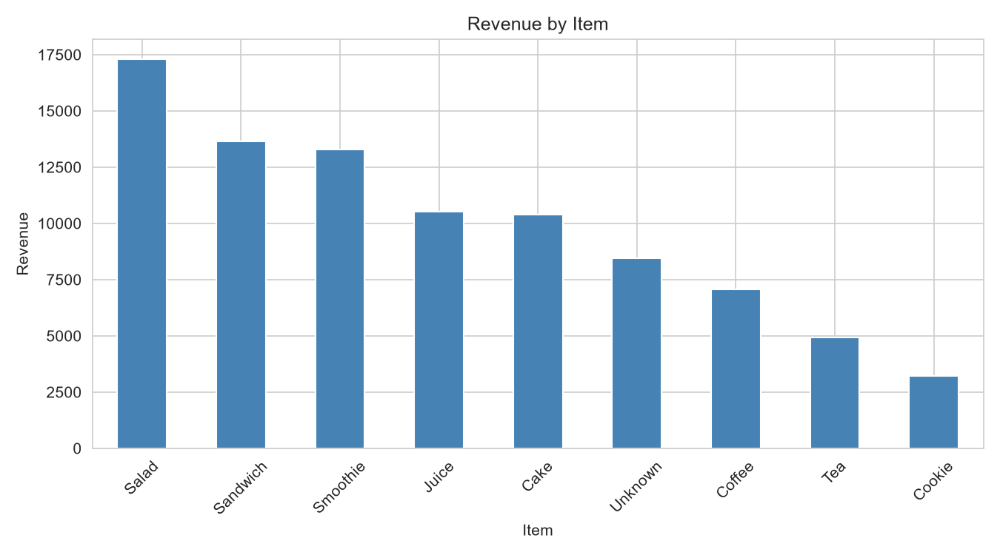
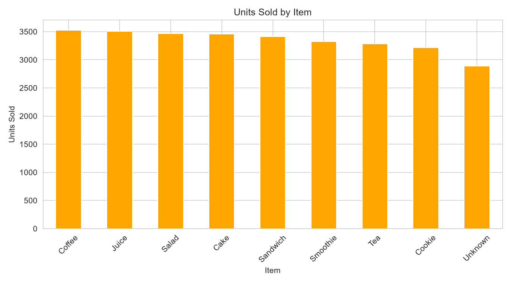
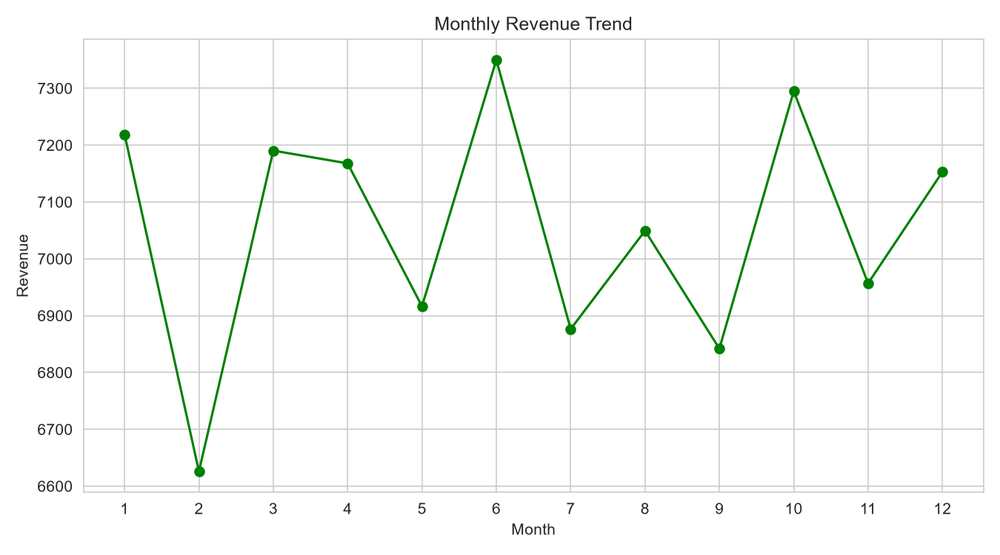
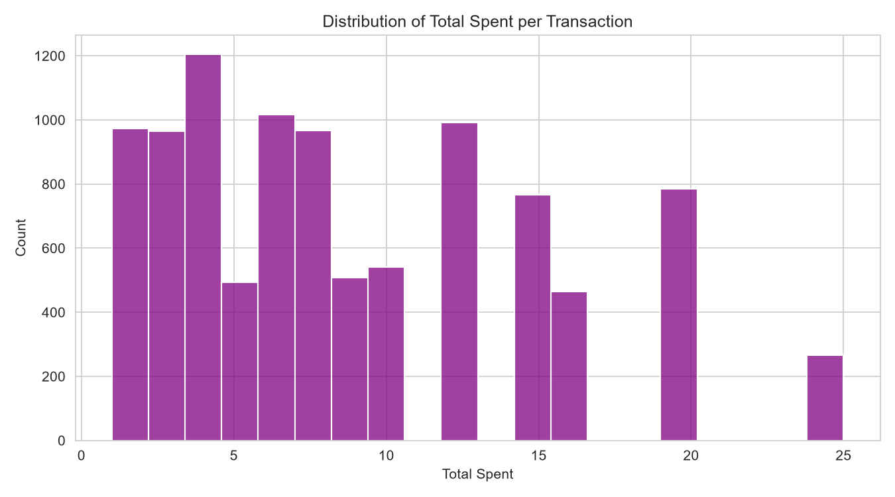
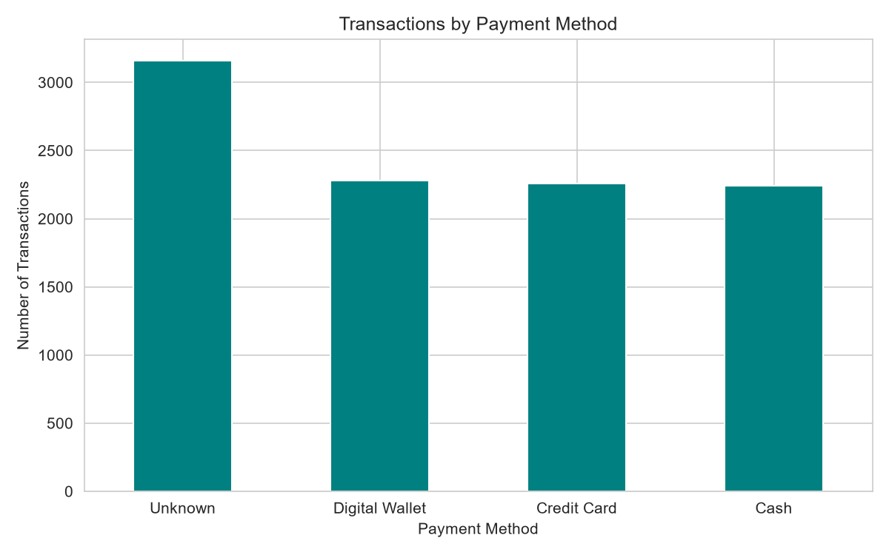

# SWYNEX Exploratory Data Analysis

## Project Overview
This is Task 2 of my SWYNEX Technologies internship. I performed exploratory data analysis (EDA) on the cleaned Cafe Sales dataset from Task 1, using Python (pandas, matplotlib, seaborn) in Jupyter Notebook.

## Dataset
- **Source:** Dirty Cafe Sales dataset (Kaggle), cleaned in Task 1
- **Size:** 9,942 transactions, 8 columns
- **Columns:** Transaction ID, Item, Quantity, Price Per Unit, Total Spent, Payment Method, Location, Transaction Date

## Files in this Repository
| File | Description |
|------|-------------|
| `cleaned_data.csv` | Cleaned dataset from Task 1 |
| `eda_analysis.ipynb` | Notebook with all analysis, charts and insights |
| `chart1` to `chart5` (.png) | Charts produced in the analysis |

## Key Statistics
| Metric | Value |
|--------|-------|
| Total transactions | 9,942 |
| Total revenue | 88,800.5 |
| Average spend per transaction | 8.93 |
| Median spend per transaction | 8.00 |
| Total items sold | 30,082 |
| Highest single order | 25.0 |

## Charts

### Revenue by Item

### Units Sold by Item

### Monthly Revenue Trend

### Distribution of Spend per Transaction

### Transactions by Payment Method

## Key Insights

1. **Salad is the top revenue driver.** It earns 17,315, about 19.5% of total revenue, and the top 3 items (Salad, Sandwich, Smoothie) together earn about 50%.
2. **Popularity does not equal revenue.** Units sold are almost equal across items (3,219 to 3,529). Coffee sells the most units (3,529) but earns only 7,058 because it costs 2 per item. Salad earned about 5.4 times more than Cookie (17,315 vs 3,219) with only 7.6% more units sold, because of price (5 vs 1).
3. **Sales are stable all year.** Monthly revenue stays between 6,626 (February, lowest) and 7,350 (June, highest), a spread of about 11%, so there is no strong seasonality.
4. **Customers spend about 8 to 9 per visit.** The average is 8.93 and the median is 8. The maximum order of 25 is valid (5 units of the 5-price item), and 267 orders (2.7%) reach it.
5. **Payment methods and locations are evenly split.** Digital Wallet (2,280), Credit Card (2,260) and Cash (2,244) are each about one-third of known transactions. Takeaway (3,004) and In-store (2,998) are nearly equal, and In-store orders average slightly more (9.03 vs 8.80).

## Anomalies and Data Quality Notes
- No rows where Total Spent differs from Quantity x Price, so the data is consistent.
- "Unknown" values remain in Item (963 transactions, 9.5% of revenue), Payment Method (3,158) and Location (3,940). These could not be recovered in Task 1, so payment and location insights use known values only.
- 457 rows have no Transaction Date, so monthly totals exclude them.

## Tools Used
Python, pandas, matplotlib, seaborn, Jupyter Notebook

## How to Run
1. Download `cleaned_data.csv` and `eda_analysis.ipynb` into one folder
2. Open the notebook in Jupyter
3. Run all cells
